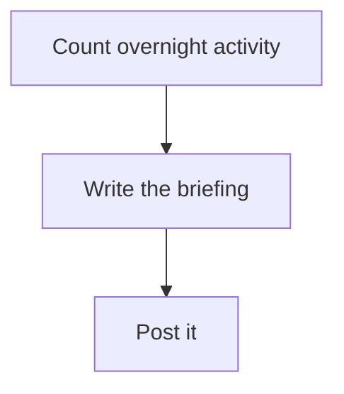

# pi-automations

Scheduled and event-driven automations for the [pi coding agent](https://pi.dev). Put an
`AUTOMATION.md` in `.agents/automations/<name>/` and pi-automations runs it on a cron schedule, or
when a script of yours finds work, in the background, so it keeps going while pi is closed. Each run
leaves a record of its steps, its answer and what it published.

pi-automations implements [Agent Automations](https://agentautomations.io) Draft 0.2. It adds the
`pa` command line, a plugin API and the Automation Manager, an optional editor that runs in your
browser.

```
Automations                                                                               watcher on

  Needs you
  ❯ ✗ nightly-report failed 3h ago
      gh: HTTP 502 while posting the report to #builds
      2 of the last 7 runs failed · l shows them
      r  run it again            or leave it: it runs again on its own today 22:00

  Running now
    ▶ team-review is running · 3m in, usually takes 7m
      now: Three reviewers read · 2 of 3 reviewers done
      s  show it

  Coming up
    tomorrow 08:00   pr-digest           ✓ 6h ago
    Mon 07:00        issue-verify        ↷ skipped 3d ago

  Watching
    every 5m         pr-review           ✓ 12d ago

  Off and disabled
    old-cleanup

↑↓ move · enter open                                                              ? help · esc close
```

## Install

```
pi install npm:pi-automations                         # once published
pi install git:github.com/OWNER/pi-automations        # from source
```

Then open pi and run `/automations` (or press `ctrl+alt+a`). Schedules and watches need the
watcher, which fires schedules and runs watch checks once a minute, with pi open or closed. Start it
once with `/automations watcher start`, or `w` on the `/automations` page.

> TODO before publishing: replace `OWNER` with the real repository owner.

## An automation

`~/.agents/automations/daily-briefing/AUTOMATION.md`:

````markdown
---
name: daily-briefing
description: Summarise what happened overnight and what needs attention today.
model: anthropic/claude-sonnet-4-5:low     # optional; the host default when absent
timeout: 10m                               # optional; bounds the whole run
on:
  schedule:
    cron: "0 7 * * MON-FRI"
    timezone: America/Los_Angeles          # optional; host-local when absent
    catch-up: once                         # skip (default) | once
  manual: true
hooks:
  pre:
    - script: scripts/overnight_counts.sh  # exit non-zero to skip the run
  post:
    - script: scripts/post_summary.py      # gets the body's answer on stdin
---

Read the counts above and write a short briefing for the morning.


````

- The frontmatter has eight fields, and the parser refuses any other field by name. `name` must
  match the folder.
- `on:` takes `schedule`, `manual` and `watch: { script, every }`. A watch script starts the run
  only when it finds new work, so a quiet hour costs no tokens.
- Pre-hook output reaches the body as delimited data, never as instructions. Post hooks always run.
- A Mermaid flowchart in the body makes it a tracked run: pi-automations moves `pre0`, `body` and
  `post0`, and the agent moves the other nodes with `pa`. See [docs/FLOWS.md](docs/FLOWS.md).
- With `flow: strict`, the body has one `## <label> {#id}` section per step, in the flowchart's
  order. `pa check` checks this, and in a run `pa next` must follow the flowchart's arrows.

Every automation is off until you arm it, whether it sits in your home directory or arrives in a
repository (`<repo>/.agents/automations/`). To arm it, you read the consent preview of exactly what
it runs and press `y`, or run `pa arm <name> --yes`. Consent is pinned to a hash of the file and its
scripts, so editing any of them turns the automation off again.

## `pa` quick reference

`pa` (also installed as `pi-automations`) has the same verbs as `/automations` inside pi.

| Command | Does |
|---|---|
| `pa` · `pa list` | list automations and their state |
| `pa run <name>` | run one now and wait (exit `0` ok · `10` skipped · `20` failed · `30` aborted) |
| `pa running` | runs in flight |
| `pa runs <name> [n]` | recent runs, with each answer and what each run published (`pa log` is an alias) |
| `pa check [name]` | re-check everything, or every detail of one automation |
| `pa arm <name>` · `pa disarm <name>` | consent to an automation (prints the preview; needs `--yes`) |
| `pa enable <name>` · `pa disable <name>` | flip `enabled:` in a user automation |
| `pa watch [name]` · `pa watch pause\|resume <name>` | inspect or dry-run a watch; pause its checks |
| `pa edit <name>` | open it in the Automation Manager when that plugin is loaded, else `$VISUAL`, `$EDITOR` or VS Code |
| `pa report [--open]` | write a self-contained HTML report |
| `pa watcher start\|stop\|status` | the watcher, which fires schedules and runs watch checks |
| `pa tick` · `pa serve` | run what is due, once · tick every minute in the foreground (containers) |

Inside a run, the body, its hooks and anything they start can report progress. `AUTOMATION_RUN` is
already set, so `pa` finds the run:

| Command | Does |
|---|---|
| `pa step <node> [-m text] [--status s]` | set one node of the run's flowchart |
| `pa next <to> [--from <node>] [-m text]` | finish one node, start the next, record the arrow taken |
| `pa say <text> [--node <node>]` | add an update to a node |
| `pa note <text> [--link "label=https://…"]` | record what the run published (works without a flowchart) |
| `pa message <text> [--link "label=https://…"]` | the run's one message for you: what happened, what needs you, with links; a later one replaces it |
| `pa status` | where the run is |

Every in-run command accepts `--json` and exits `0` ok, `1` usage, `2` refused.

The last run's message shows on the `/automations` page under the selected automation, links first.
It also shows on the automation page, the runs page and the Automation Manager's History. A run
that left no message shows its notes instead, and a run with neither shows its answer.

### Exit codes

| Outcome | Code |
|---|---:|
| `ok` | `0` |
| `skipped` | `10` |
| `failed` or `missed` | `20` |
| `aborted` (stopped by a person) | `30` |
| run process ended by an operating-system signal | `0` |

A run process that never starts, or returns an unreadable completion, exits `20`.

## Plugins

Plugins are loaded only from your own config, never from a repository:

```jsonc
// ~/.pi/agent/pi-automations/config.json
{ "plugins": ["manager"] }
```

`manager` is the bundled Automation Manager. Press `e` on an automation to edit its triggers,
hooks, body, flowchart and files in a browser, follow its runs on their flowcharts, and read every
run's message in History. Any other entry is an absolute or `~/` path to your own module. Plugins
observe runs, add actions and draw flowcharts; see [docs/PLUGINS.md](docs/PLUGINS.md) and
[packages/manager](packages/manager/README.md).

## Drawing flowcharts with fm (optional)

pi-automations records progress and notes with no extra tool. Without a renderer, a flowchart shows
as a step list. If an `fm` that answers `fm render --help` is installed (see the fm repository, TODO:
link), it draws the run's flowchart in the terminal and in the HTML report. Point `fmPath` (or
`FM_BIN`) at it when it is not on `PATH`. An unrelated npm package is also called `fm`.

## Configuration

`~/.pi/agent/pi-automations/config.json`. Every key is optional. A bad value gives a warning, and
the default applies.

```jsonc
{
  "grace": "10m",             // the grace period: how late a run may start and still be on time
  "catchUpWindow": "7d",      // how far back `catch-up: once` looks
  "defaultTimeout": "20m",    "maxTimeout": "4h",
  "hookTimeout": "60s",       "hookMaxOutputBytes": 1048576,
  "staggerMaxSeconds": 120,   // spread automations due at the same minute
  "consentExpiry": "30d",     // repository automations only; user consent does not expire
  "notifyOnFailed": true,     // desktop notification when a run fails
  "retention": { "maxLinesPerAutomation": 2000, "keepLines": 500 },
  "worktree":     { "<automation key>": true },   // run in a throwaway git worktree
  "flowTracking": { "<automation key>": true },   // track runs without their own flowchart
  "fmPath": "/usr/local/bin/fm",
  "plugins": ["manager"],
  "piModule": "/path/to/@earendil-works/pi-coding-agent"  // only if background runs cannot find pi
}
```

State (consent, run records, locks, logs, reports) lives in `~/.pi/agent/pi-automations/`, never
inside a repository. `pa watcher stop --purge` removes it; automations are never touched.

Scheduled runs do not read your shell profile, so log in with `pi /login` rather than relying on
API-key environment variables. Credential-shaped variables are never passed to hooks or written to
the watcher's job files.

## Requirements

- Node.js ≥ 22.19
- pi (`@earendil-works/pi-coding-agent`) ≥ 0.84.4. Tested with 0.84.4, 0.85.1, 0.99.2 and 1.2.0
  ([evidence](docs/pi-sdk-lifecycle-matrix.json)).
- Windows (Task Scheduler), macOS (launchd) or Linux (systemd user timer, or cron) for the
  watcher; `pa serve` works anywhere.

## Documentation

- [Agent Automations](https://github.com/lucas-stanford/agent-automations): the Draft 0.2
  specification and its documentation site.
- [skills/agent-automations](skills/agent-automations/SKILL.md): a host-neutral Agent Skill that
  teaches an agent to write automations for any host of the format. The spec site publishes it, and
  other agents can copy the folder into `.agents/skills/`.
- [skills/pi-automations](skills/pi-automations/SKILL.md): the Agent Skill for this host: checking,
  arming, running and scheduling with `pa`, its defaults, and how a run reports. Not on the site.
  Both ship with the package, so pi lists `agent-automations` and `pi-automations`.
- [docs/FLOWS.md](docs/FLOWS.md): progress, notes and the flowchart
- [docs/PLUGINS.md](docs/PLUGINS.md): writing a plugin
- [docs/PROVIDERS.md](docs/PROVIDERS.md): composing the core for another host
- [docs/DESIGN.md](docs/DESIGN.md): the decisions behind it
- [CONTRIBUTING.md](CONTRIBUTING.md)

## License

[MIT](LICENSE)
