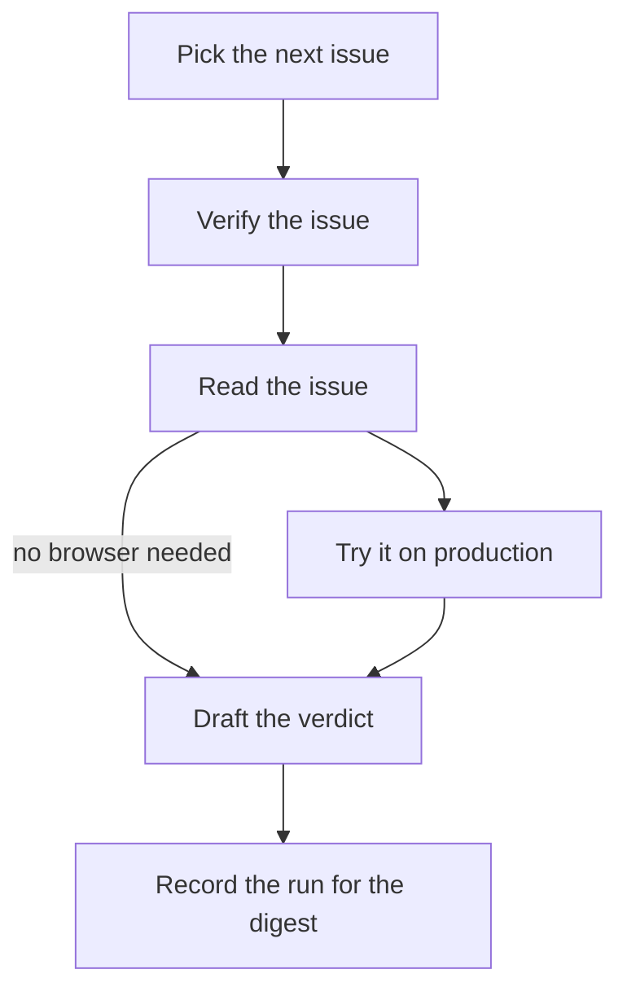

# Progress, notes and the flowchart

pi-automations runs an automation and records how far it has got on a Mermaid flowchart: which
step is going, which steps are done, and which way the run went at each branch. For the run as a
whole it keeps notes, with links to whatever the run published.

pi-automations moves the reserved nodes (pre hooks, the body, post hooks). The agent moves the
other nodes with `pa`, from inside the run. When the run ends, all of it goes into the run record.
Notes do not need a flowchart: every run can leave them (see [§4](#4-notes-and-links)). No other
tool is needed; [fm](#drawing-it), when installed, only draws the flowchart.

```
demo · run 20260917-070001-3fa2
  ✓ pre0       done      Pick the next issue — PICK #12
  ▶ body       active    Verify the issue
  ✓ read       done      Read the issue — Reading #12
  · reproduce  pending   Try it on production
  ▶ draft      active    Draft the verdict — no browser needed
  · post0      pending   Record the run for the digest
taken  pre0→body, read→draft
note   Drafted the verdict for #12
       issue: https://github.com/o/r/issues/12
```

---

## 1. Track a run

Put a Mermaid flowchart in `AUTOMATION.md`. The first fenced `mermaid` block in the body that starts
with `flowchart` or `graph` is the run's flowchart. Nothing needs configuring:

````markdown
# Verify one issue


````

Older automations that still have a `flow.mmd` beside `AUTOMATION.md` keep working. If both exist,
the block in `AUTOMATION.md` wins.

To track an automation that has no flowchart of its own, name it in config:

```jsonc
// ~/.pi/agent/pi-automations/config.json
{ "flowTracking": { "user:/home/you/.agents/automations:daily-briefing": true } }
```

The key is the automation key; `/automations check <name>` prints it. Without its own flowchart,
the run is tracked on the shape it already has: pre hooks, the body, post hooks, in order.

To track one run only, press `f` on its row in `/automations` ("run and follow its flowchart").
Nothing durable changes, and the next scheduled run behaves as before.

The listing marks tracked automations with `⋔`. The marker describes the automation, not your
machine, so a repository automation shows the same marker for everyone who checks it out.

## 2. What pi-automations moves

| Node id | Is | Moved |
|---|---|---|
| `pre0`, `pre1`, … | pre hooks, in declaration order | active when it starts, then done, failed or skipped |
| `body` | the Markdown body, the prompt sent to the model | active when the body starts, done or failed when it ends |
| `post0`, `post1`, … | post hooks, in declaration order | active, then done or failed |

A flowchart may leave any of these out; pi-automations does not move a node the flowchart does not
have. The agent moves every other node.

## 3. Report from inside the run

The body, every hook and everything they start get these variables:

| Variable | |
|---|---|
| `AUTOMATION_RUN` | the run id its progress is kept under; every run |
| `AUTOMATION_STATE_DIR` | where the progress file is; every run |
| `AUTOMATION_NODE` | the node this process works on: `body` for the body, `pre0`… for a hook; tracked runs only |

so `pa` needs no arguments to find the run. The body of a tracked run is also told how to report,
in a short block added to its prompt:

```
<progress>
This run is tracked on its flowchart. Report where you are with `pa` (AUTOMATION_RUN is already set):
- `pa step <node> [-m "text"] [--status active|waiting|done|failed|skipped]` — set one node (default active)
- `pa next <to> --from <node> [-m "text"]` — finish <node> and start <to>
- `pa say "text" [--node <node>]` — add an update to a node
- `pa note "text" --link "label=https://…"` — a note on the run's record, with the links you published
- `pa status` — where the run is; any command takes `--json`
Nodes: pre0, body, read, reproduce, draft, post0 (or their exact labels).
Subagents inherit AUTOMATION_RUN; set AUTOMATION_NODE=<its node> for each so its `pa say`/`pa next` land there.
When the instructions ask you to record what you published or to leave a message, use these commands.
Before you finish, leave the reader ONE message: `pa message "what happened / what needs you" --link "label=https://…"`. Links matter most; a later message replaces the earlier one.
If `pa` fails, carry on.
</progress>
```

| Command | Does |
|---|---|
| `pa step <node> [--status s] [-m text]` | changes exactly one node; `active` by default |
| `pa next <to> [--from <node>] [-m text]` | marks `<node>` done and `<to>` active, and records the arrow as taken. `--from` defaults to `AUTOMATION_NODE`, else the one running node |
| `pa say <text> [--node <node>] [--request-id <key>]` | adds an update to a node (same default as `--from`) |
| `pa note <text> [--link "label=URL"]… [--request-id <key>]` | a note on the run, not tied to a node |
| `pa message <text> [--link "label=URL"]… [--request-id <key>]` | the run's one message for its reader; a later one replaces it |
| `pa status [--json]` | every node, the arrows taken, the notes, the message |

Name a node by its exact id, or by its exact label when no other node has that label. `pa` refuses
an unknown node and suggests the ones you probably meant.

Strict flow: with `flow: strict` in the frontmatter, each `##` section of the body is one step
(`## Read the issue {#read}`), and `pa next` must follow an arrow of the flowchart. Any other move
is refused with `NOT_AN_EDGE`. Moves between hooks and the body belong to pi-automations and are
not checked. The `<progress>` block gets one more line that asks for
`pa next <id> --from <the step before>`.

Retries change nothing. The same `step` or `next` a second time appends nothing and answers
`"changed": false`. With `--request-id`, a `say`, `note` or `message` is recorded once however often
it is retried.

Several writers can report at once. Every write takes a short lock and checks the file inside that
lock, so two processes can never both see a node as untouched and both move it. A fan-out relies on
this: give each subagent its own `AUTOMATION_NODE`, and let each branch finish with
`pa next gather --from <branch>`. The branches meet at `gather`, and each arrow is recorded once.

An update, note or message longer than 4 000 characters is cut there with a warning, not refused.

### Output and exit codes

With `--json`, every command answers with one JSON object on stdout, on success and on failure:

```json
{"ok":true,"changed":true,"warnings":[],"data":{"run":"20260917-070001-3fa2","node":{"id":"draft","label":"Draft the verdict","status":"active","text":"no browser needed"}}}
{"ok":false,"error":{"code":"UNKNOWN_NODE","message":"no node \"raed\" on this run's chart","suggestions":["read (\"Read the issue\")"]}}
```

Without `--json`, a command prints a line for a person on stdout and errors on stderr.

| Exit | Code | |
|---:|---|---|
| `0` | | ok |
| `1` | `USAGE` | a missing argument or an unknown option |
| `1` | `BAD_LINK` | a link that is not `http`/`https`; nothing is written |
| `2` | `NO_RUN` | not inside a run: `AUTOMATION_RUN` is not set |
| `2` | `UNKNOWN_RUN` | no such run here |
| `2` | `RUN_CLOSED` | the run has ended; its progress is in its run record |
| `2` | `NO_CHART` | `step`, `next` or `say` in a run with no flowchart; only `note`, `message` and `status` work there |
| `2` | `UNKNOWN_NODE` · `AMBIGUOUS_NODE` | the node is not on the flowchart, or two nodes share the label |
| `2` | `NO_ACTIVE` · `AMBIGUOUS_ACTIVE` | `--from` or `--node` was left to default, and no node, or more than one, is running |
| `2` | `NOT_AN_EDGE` | `flow: strict` only: `next` along an arrow the flowchart does not have; the suggestions are where it can go |
| `2` | `LOCK_TIMEOUT` · `IO` | the progress file could not be written |

## 4. Notes and links

A note records what the run published and where: a review posted, a page updated, a message sent.
Every run can leave notes, with or without a flowchart. The body gets `AUTOMATION_RUN` and
`AUTOMATION_STATE_DIR` like any other, and this block:

```
<notes>
When the instructions ask you to record what you published or to leave a message, use these commands.
If you publish anything or leave something for the reader, record it with `pa note "what it is" --link "label=https://…"` (AUTOMATION_RUN is already set).
Before you finish, leave the reader ONE message: `pa message "what happened / what needs you" --link "label=https://…"`. Links matter most; a later message replaces the earlier one.
If `pa` fails, carry on.
</notes>
```

```
pa note "Posted the review on o/r#7" --link "review=https://github.com/o/r/pull/7#pullrequestreview-1"
pa note "Digest published, team notified" --link "digest=https://example.com/digest" --link "https://chat.example.com/m/123"
```

The text is Markdown. A link is `label=URL` or the URL alone, and only `http` and `https` links are
kept. `pa` splits `label=URL` on the first `=` only when a URL follows it, so a URL's own query
string stays whole. A note with one bad link is refused whole. A link is kept as the URL parser read
it, and control characters are removed from labels, notes and messages, so nothing an agent writes
can reach your terminal as an escape sequence.

Notes show with clickable links (OSC 8, in terminals that support it) on the run page, under the
last run on the automation page (`enter`), under the selected run on the runs page (`l`), in
`pa runs <name>`, in the transcript entry and in the HTML report.

### The message

Notes log what a run published. The message is what the run says to you when it is done: what
happened, what needs you, and links to go there.

```
pa message "2 PRs wait on you: #11911 needs a re-review, #11920 has a failing check" --link "digest=https://example.com/digest" --link "PR #11911=https://github.com/o/r/pull/11911"
```

A run keeps one message: a later `pa message` replaces the earlier one. Text and links follow the
same rules as a note's. The message comes first wherever the run appears: on the `/automations`
page under the selected automation (links before text when rows are short), as `Message` on the
automation page and the run page, first on the runs page (`l`), in `pa runs` and `pa status`, and
at the top of the Automation Manager's run page and History. A run that left no message shows its
notes there instead, and a run with neither shows its answer.

## 5. Where it is kept

While a run is going, tracked or not, its progress is one small append-only events file:

```
~/.pi/agent/pi-automations/progress/<run id>.jsonl
```

It sits in the state directory with everything else, never inside a repository. When the run
ends, pi-automations closes the file and folds it into the run record:

| Field | |
|---|---|
| `chart` | the Mermaid flowchart the run was tracked on, so it can be drawn again later |
| `steps` | every node, in flowchart order: `id`, `label`, `status`, the latest update, `startedAt`, `endedAt` |
| `taken` | the arrows the run took, `[from, to]` |
| `notes` | `{ ts, text, links: [{ label?, url }] }`, oldest first |
| `message` | the last `pa message`: `{ ts, text, links }` |

A run without a flowchart keeps only `notes` and `message`. Then the file is removed. A node still
`active` or `waiting` when the run ended is recorded as `interrupted`: it did not finish, and the
record says so. A small `<run id>.closed` marker stays for a week, so a subagent that reports after
the end hears `RUN_CLOSED` instead of being told the run never existed. When a run's process dies,
the next tick writes an `aborted: host stopped` record for it and folds the progress file into
that record the same way.

Records written before this existed lack these fields.

## 6. Following it

The `/automations` page shows a tracked run's steps, with each node's label and latest update as it
goes. On the run page, `g` shows the flowchart, and the page lists the notes with their links and,
once the run has finished, where every node got to. `pa runs <name>` prints the recent runs with
their notes and links; `/automations report` draws each automation's last run with its notes. With
the Automation Manager [plugin](PLUGINS.md), its Runs tab draws each run on its flowchart, live
while it runs.

## Drawing it

fm is optional and only draws. (TODO before publishing: link the fm repository.) In the terminal,
pi-automations first asks a [plugin](PLUGINS.md#drawing-flowcharts) that supplies a renderer.
Otherwise, when an fm that can render is installed, pi-automations asks it to draw the flowchart:

```
fm render --plan <file> --state - --format text      # the terminal (/automations)
fm render --plan <file> --state - --format svg       # the report
```

with the run's flowchart as the plan and, on stdin, where each node got to:

```json
{"nodes": {"pre0": "done", "body": "active", "read": "done"}, "taken": [["pre0", "body"]]}
```

Statuses are `pending`, `active`, `waiting`, `done`, `failed`, `skipped` and `interrupted`.

pi-automations finds fm from `fmPath` in `config.json`, else `FM_BIN`, else `fm` on `PATH`, and uses
it only if `fm render --help` succeeds, checked once per binary. An explicit `fmPath` is used or
refused; there is no fallback from it.

> An unrelated npm package is also called `fm`, and `npm i -g fm` installs that one. It fails
> `fm render --help`, so pi-automations never runs it.

Without fm, or when fm fails on a flowchart, the flowchart shows as a step list (glyph, label, status
and latest update), never as an error. A flowchart wider than the pane is never clipped: the step
list shows instead, with the flowchart's width.

## 7. Guarantees

Progress cannot break a run. When the store cannot be written, the run records one problem
(`flow.problem`) and the store goes quiet; the automation's outcome is untouched. The run still
tries to fold in what was recorded before the problem.

Tracking does not change behaviour. The same hooks run in the same order with the same output. If
you delete every flowchart, the runs stay the same, except that the body's prompt no longer gets the
guide.

Nothing is inferred. A node is `done` only when the step that owns it said so, or when a `next`
left it.

Tracking is composed in. The pi host composes the core progress store; a host that composes nothing
runs every automation untracked. See [docs/PROVIDERS.md](PROVIDERS.md) §5.

## 8. Troubleshooting

| What you see | Why |
|---|---|
| `pa: not inside a run` | `pa` ran outside a run, so `AUTOMATION_RUN` is not set. |
| `RUN_CLOSED` from a subagent | It reported after the run ended. Its report is dropped on purpose: the run is over. |
| `AMBIGUOUS_ACTIVE` | Several nodes are running and `--from`/`--node` was left to default. Pass it, or set `AUTOMATION_NODE`. |
| Run record has no `steps` | The run was not tracked, or `flow.problem` on the record says why tracking could not start. |
| The flowchart is a list, not a drawing | No fm answers `fm render --help`, or fm failed on this flowchart. |

### `pi: cannot find @earendil-works/pi-coding-agent from a background run`

This is not a progress problem, but it shows up the same way: as a `skipped` record instead of a
run.

A background run is a plain `node` process, not a pi session, so it has to find the pi SDK on disk,
and pi does not install itself next to an extension package. A run normally finds pi from whichever
session or watcher started it, or from the `pi` on your `PATH`. If it reports this, none of those
worked. Point it at pi directly:

```jsonc
// ~/.pi/agent/pi-automations/config.json
{ "piModule": "/usr/lib/node_modules/@earendil-works/pi-coding-agent" }
```

The run still took its lock and wrote a record, so nothing is lost and nothing is stuck.
