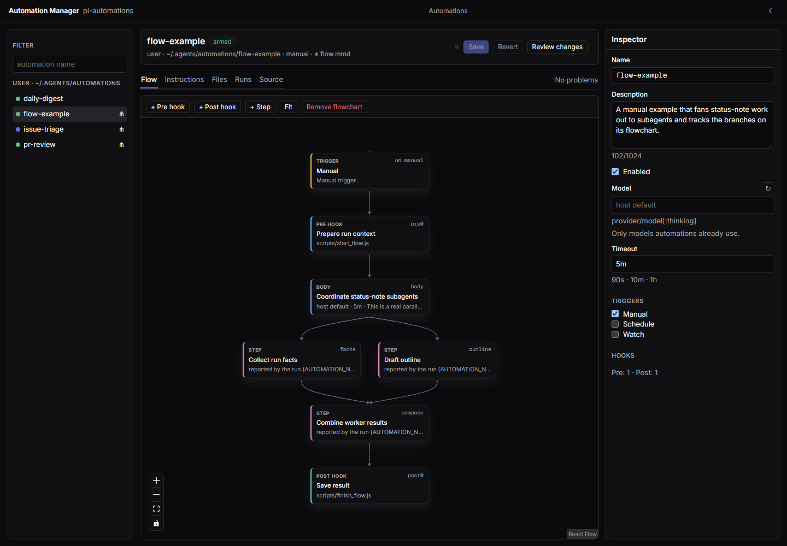

# Automation Manager

A browser editor for [pi-automations](../../README.md). It shows a whole automation on one screen:
its triggers, hooks, body, flowchart, the files in its folder and its runs. Your edits are saved
through pi-automations' own parser and validation.



## Setup

The Automation Manager ships inside pi-automations as the `manager` plugin. Enable it in
`~/.pi/agent/pi-automations/config.json`:

```json
{ "plugins": ["manager"] }
```

Then press `e` on an automation in `/automations`, run `/automations edit <name>`, or run
`pa edit <name>` in a shell. The first edit starts a local server on `127.0.0.1` and opens your
browser on that automation. In pi the server lives as long as the pi session; `pa edit` keeps it
running until Ctrl+C (`--no-open` prints the URL instead of opening a browser). Without the plugin,
`e` and `pa edit` open `AUTOMATION.md` in your text editor.

## What you can do

- Browse every automation pi-automations found, with its state, schedule or watch, next run and
  recent outcomes.
- Edit the flowchart: add, remove and reorder pre and post hooks, add and remove steps, relabel
  nodes, and restyle or remove arrows. The chart lives in `AUTOMATION.md` as a ```` ```mermaid ````
  block. A chart the visual editor cannot round-trip opens as text with a live preview.
- Edit settings in the Inspector: description, enabled, model (with suggestions from the models pi
  can run), timeout, manual, schedule (with the cron in words and the next run times) and watch.
- Edit the body as Markdown with a rendered preview, and any other text file in the folder.
- Follow runs on their flowchart, including a run that is still going: where each step got to, the
  arrows taken, notes and their links, hooks and the answer. Each run page leads with the run's
  message (`pa message`) and its links.
- Read History: every automation's runs, newest first, each led by its message and its links as
  buttons (or its notes, or what it said). Filter by automation, by outcome, or to runs that left a
  message. A row opens that run on its automation's Runs tab.
- Review and save with Ctrl/Cmd+S. Edits go into the existing file, keeping comments, key order and
  quoting, and pi-automations checks them first. An invalid draft is refused with its reasons
  unless you choose *Save anyway*. If the file changed on disk since you opened it, nothing is
  overwritten until you reload, review the diff or choose to overwrite.

Saving an automation, user or repository, returns it to `off` until you arm it again: consent is
pinned to the exact bytes. Running, arming and scheduling stay in pi-automations.

## Security

The server writes files that pi-automations later runs, so it only serves the local browser:

- It listens on loopback only and rejects any `Host` other than its own address, which blocks DNS
  rebinding.
- Writes need a per-launch token that only the page can read, a JSON content type, and a
  same-origin `Origin` / `Sec-Fetch-Site` when the browser sends them. No CORS headers are sent.
- Pages are served with a strict Content Security Policy and no framing.
- File access stays inside the automation folder: no absolute paths, `..`, links or junctions, and
  only UTF-8 text up to 1 MiB. `AUTOMATION.md` and `flow.mmd` are only written through the
  validated save.

## Development

Requires Node 22.19+ and npm. The server tests import pi-automations' built `dist/` from the
repository root, so run `npm ci` there as well.

```sh
npm ci
npm run dev    # the app on http://localhost:5173
```

The app needs a running server. Start one with `pa edit <name> --no-open`, then point the dev server
at it:

```sh
MANAGER_URL=http://127.0.0.1:<port> npm run dev    # PowerShell: $env:MANAGER_URL = "..."; npm run dev
```

| Command | |
|---|---|
| `npm run build` | type-check, then build the app into `dist/` and the plugin into `plugin/` |
| `npm test` | unit and component tests, and the server against pi-automations' host services (Vitest) |
| `npm run test:e2e` | browser tests (Playwright) against a mock server over `e2e/fixtures/` |

`dist/` and `plugin/` are committed, because pi-automations is installed from git without building
it; rebuild them with `npm run build` when you change the app or the server. The plugin bundle uses
Node built-ins only.

### Layout

```
server/      the plugin (plugin.ts), its HTTP server (server.ts) and automation ids
src/host/    the HTTP contract shared by server and app, and the browser client
src/monitor/ the editor: draft model, Mermaid flowchart parser/serializer and UI components
src/theme/   colour tokens and the theme hook
e2e/         Playwright tests, fixtures and the mock server
```