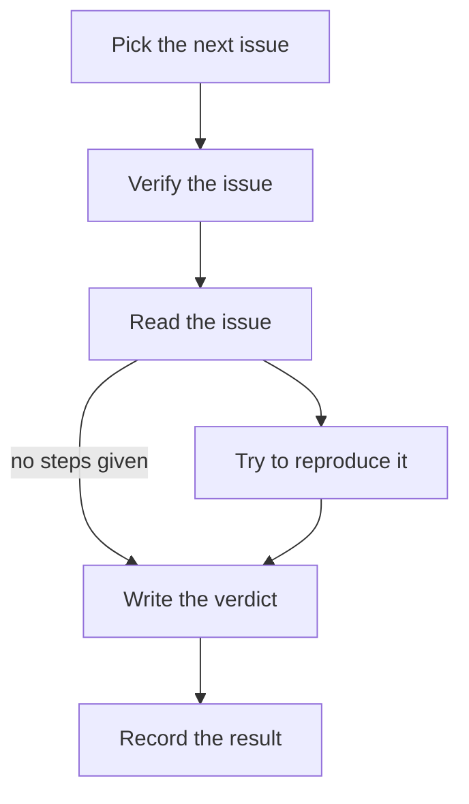
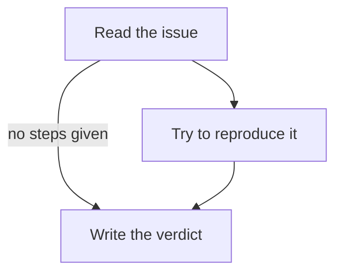

# Flowcharts

> Optional. A chart of the run's steps in the body, and a field that holds the body to it.

Everything on this page is optional. An automation does not need a flowchart, and a host does not need to read one. Without a chart the body is plain Markdown and the [Specification](specification.md) is complete.

A host that does not implement this page **must** still accept `flow: loose` and **must** refuse `flow: strict`, so an automation never runs without the checks it asked for. A chart in a body it does not read is ordinary text.

## Flowchart

The body **may** contain a Mermaid flowchart of the run's steps. By convention it is the first `mermaid` block, right under the title:

````markdown automation title=".agents/automations/issue-verify/AUTOMATION.md"
---
name: issue-verify
description: Pick the next unverified issue and check whether it still reproduces.
on:
  schedule: "0 9 * * MON"
  manual: true
hooks:
  pre:
    - script: scripts/next_issue.js
  post:
    - script: scripts/record.js
---

# Verify one issue



Read the issue in the input block. If it has steps, try them; then write a short verdict.
````

- The chart is the first fenced `mermaid` block in the body whose diagram starts with `flowchart` or `graph`.
- Node ids `pre0`, `pre1`, … `body`, `post0`, `post1`, … are reserved for the pre hooks, the body and the post hooks, in declaration order. A chart may leave any of them out. Every other node is a step inside the body.
- The chart is part of the body, so the agent reads it with the rest of its prompt. A host that does not track progress treats it as ordinary text.
- An older layout kept the chart in a separate `flow.mmd` beside `AUTOMATION.md`. A host **may** still read it; when both exist, the block in `AUTOMATION.md` wins. New automations **should not** use `flow.mmd`.

A host **may** show how far a run has got on its chart. How it does so is up to the host; [pi-automations](reporting.md) is one example.

## `flow` field

- `loose` or `strict`. Absent means `loose`. Anything else is refused.
- `loose`: the body is free Markdown. A [flowchart](#flowchart), if it has one, shows the steps; nothing ties it to the text.
- `strict`: the body **must** have a flowchart, and its `##` sections **must** match the chart's steps one to one, in the chart's order. The rules are in [Strict flow](#strict-flow).

```yaml frontmatter invalid="flow: \"tight\" is not loose or strict"
name: tight-review
description: Review the branch.
flow: tight
on:
  manual: true
```

## Strict flow

With `flow: strict` the chart is the body's table of contents: each step on the chart is one `##` section, and each section is one step. A host checks this when it validates the file:

1. **A chart.** The body has a flowchart, found as above. `flow: strict` without one is refused.
2. **One section per step.** Every step node (every node except `pre0`…, `body`, `post0`… and the ids of `subgraph` groups) has exactly one level-2 section. Its heading is the node's label followed by its id in braces: `## Read the issue {#read}`.
3. **Every `##` is a step.** A `##` heading without `{#id}`, with an id that is not on the chart, or with a hook's or the body's id is refused. Text before the first `##` (the title, an introduction, the chart) is free, and `###` and deeper headings belong to the section above them. Headings inside code fences do not count.
4. **The heading is the label.** The heading text before `{#id}` equals the node's label, compared as plain text: entities such as Mermaid's `#quot;` and HTML's `&amp;` are decoded, Markdown emphasis, links and code marks are dropped, quotes are dropped, `<br/>` in a label is a space, and runs of whitespace are one space. Case matters.
5. **The chart's order.** Arrows that are part of a loop are not ordered: steps that can reach each other through the arrows (a retry, a fix-and-check-again) form one group, in any order among themselves. Every other arrow `a --> b` between two steps orders their groups: each section in `a`'s group comes before each section in `b`'s. A step on no loop is a group of one, so for a plain arrow `a`'s section comes before `b`'s. The result does not depend on the order the chart lists its arrows.
6. **Branches say where they go.** A step with arrows to two or more steps names each of them in its section, by id as a word (`repro`, `#repro`, `go to repro`) or by label, in any case.

A strict body that breaks the rules is refused with every problem at once, joined by `; `, each with the line of the file it is on.

````markdown automation title=".agents/automations/issue-verify/AUTOMATION.md"
---
name: issue-verify
description: Pick the next unverified issue and check whether it still reproduces.
flow: strict
on:
  schedule: "0 9 * * MON"
  manual: true
hooks:
  pre:
    - script: scripts/next_issue.js
  post:
    - script: scripts/record.js
---

# Verify one issue


The issue is in the input block.

## Read the issue {#read}

Read it and its comments. If it gives steps, go to `repro`; if not, go straight to the verdict.

## Try to reproduce it {#repro}

Follow the steps on the latest release, and note what you saw.

## Write the verdict {#verdict}

One paragraph: still reproduces, fixed, or cannot tell, and why.
````

~~~~markdown automation dir=issue-verify invalid="flow: line 18: \"## Read the issue\" has no node id — write `## Read the issue {#read}`; line 22: section `verdict` comes before `repro` (line 26), but the chart goes repro → verdict — move `verdict` below `repro`"
---
name: issue-verify
description: Check whether the next issue still reproduces.
flow: strict
on:
  manual: true
---

# Verify one issue



## Read the issue

If it gives steps, go to `repro`; if not, to the verdict.

## Write the verdict {#verdict}

Still reproduces, fixed, or cannot tell.

## Try to reproduce it {#repro}

Follow the steps.
~~~~

~~~~markdown automation dir=issue-verify invalid="flow: line 18: section `read` branches to `repro` and `verdict` but never mentions `verdict` (\"Write the verdict\") — say when to go there, for example `then go to verdict`"
---
name: issue-verify
description: Check whether the next issue still reproduces.
flow: strict
on:
  manual: true
---

# Verify one issue


## Read the issue {#read}

Read it. If it gives steps, go to `repro`.

## Try to reproduce it {#repro}

Follow the steps.

## Write the verdict {#verdict}

Still reproduces, fixed, or cannot tell.
~~~~
