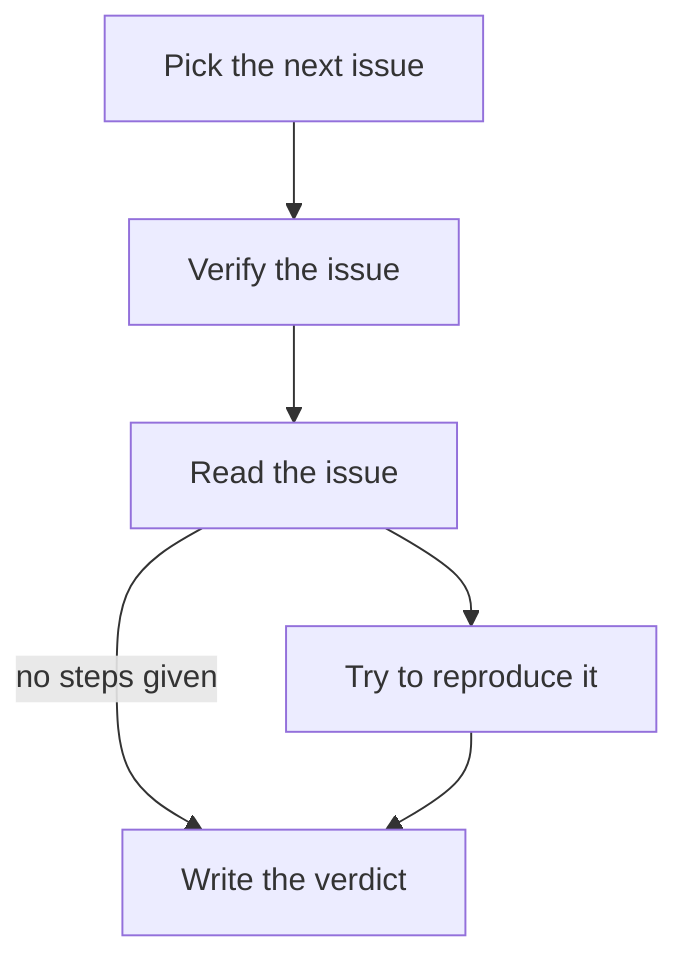

# Reporting progress, notes and the message

> How a run reports where it has got to, what it published, and its one message for you, with the pa command.

A run's record says how it ended. Progress and notes say what happened on the way: which step it is on, which way it went at a branch, and what it published, with links. The message is the one thing it says to you at the end.

> [!NOTE]
> Draft 0.2 does not define progress reporting. This page describes pi-automations, where it is built in. A body can ask for receipts in plain words, as in [Ask for receipts](best-practices.md#ask-for-receipts): the block the host adds to every prompt tells the agent which commands those words mean. If a body names `pa`, write "If `pa` fails, carry on" too, so the same automation still works on a host without it.

## What a person sees

While a run is going, the `/automations` page shows its steps with each step's latest update. When it ends, pi-automations folds everything into the run record, which shows on its run page, in `pa runs <name>`, in the transcript entry and in the HTML report:

```text
issue-verify · run 20260917-070001-3fa2
  ✓ pre0       done      Pick the next issue — PICK #12
  ✓ body       done      Verify the issue
  ✓ read       done      Read the issue — Reading #12
  · repro      pending   Try to reproduce it
  ✓ verdict    done      Write the verdict — no steps given
taken  pre0→body, read→verdict
note   Posted the verdict on #12
       issue: https://github.com/OWNER/pi-automations/issues/12
message #12 still reproduces on 0.4; it needs a fix before Friday's release
        issue: https://github.com/OWNER/pi-automations/issues/12
```

Links in notes and messages are clickable in terminals that support them. The `/automations` page shows the selected automation's last message under the list. With the Automation Manager plugin, the browser also draws each run on its flowchart, and History lists every run with its message first.

## Notes

A note records what the run published and where, such as a review it posted or a page it updated. Every run can leave notes, with or without a chart.

```sh
pa note "Posted the weekly digest" --link "digest=https://example.com/digests/2026-w10"
pa note "Reviewed two pull requests" --link "https://github.com/OWNER/pi-automations/pull/7" --link "https://github.com/OWNER/pi-automations/pull/9"
```

- The text is Markdown.
- A link is `label=URL` or a bare URL, and `--link` can be repeated. Only `http` and `https` links are kept, and a note with one bad link is refused whole.
- `--request-id <key>` makes a note exactly-once: a retry with the same key adds nothing.
- Text longer than 4000 characters is cut, with a warning. Control characters are removed, so nothing an agent writes can reach a terminal as an escape sequence.

## The message

Notes are the run's log. The message is what a person reads first: what happened, what needs them, and the links to go there. End each run with one.

```sh
pa message "Digest is up; 2 pull requests wait on you" --link "digest=https://example.com/digests/2026-w10" --link "https://github.com/OWNER/pi-automations/pull/7"
```

- A run keeps one message. A later `pa message` replaces the earlier one.
- Links matter most. Text, links, `--request-id` and the limits work as for a note.
- A run that leaves no message is shown by its notes, or else by what it answered.

The host already tells the agent about notes and the message, in a short block added to the prompt:

```text
<notes>
When the instructions ask you to record what you published or to leave a message, use these commands.
If you publish anything or leave something for the reader, record it with `pa note "what it is" --link "label=https://…"` (AUTOMATION_RUN is already set).
Before you finish, leave the reader ONE message: `pa message "what happened / what needs you" --link "label=https://…"`. Links matter most; a later message replaces the earlier one.
If `pa` fails, carry on.
</notes>
```

## Progress on the flowchart

A run is tracked step by step when the body has a Mermaid flowchart: the first `mermaid` block whose diagram starts with `flowchart` or `graph`. To track an automation without its own chart, list its automation key under `flowTracking` in the host config; pi-automations then tracks it on its hooks and body, in order.

The host moves the nodes it owns. The agent moves the rest.

| Node id | Is | Moved by |
|---|---|---|
| `pre0`, `pre1`, … | The pre hooks, in order | The host: active when it starts, then done, failed or skipped |
| `body` | The Markdown body | The host: active when the body starts, done or failed when it ends |
| `post0`, `post1`, … | The post hooks, in order | The host |
| anything else | A step inside the body | The agent, with `pa` |

A chart may leave out any of the reserved nodes, and the host moves only the nodes the chart has.

| Command | Does |
|---|---|
| `pa step <node> [--status s] [-m "text"]` | Sets one node. `active` by default; `--status` takes `active`, `waiting`, `done`, `failed` or `skipped`. |
| `pa next <to> [--from <node>] [-m "text"]` | Marks `<node>` done and `<to>` active, and records the arrow as taken. |
| `pa say "text" [--node <node>] [--request-id <key>]` | Adds an update to a node. |
| `pa note "text" [--link "label=URL"]… [--request-id <key>]` | A note for the run, not tied to a node. |
| `pa message "text" [--link "label=URL"]… [--request-id <key>]` | The run's one message for its reader. The last one wins. |
| `pa status [--json]` | Every node, the arrows taken, the notes, the message. |

A node is named by its id or by its exact label, when only one node has it. An unknown name is refused with the ones it probably meant. `--from` and `--node` default to `AUTOMATION_NODE`, else to the one node that is running.

> [!TIP]
> The body's `AUTOMATION_NODE` is `body` when the chart has a `body` node. A bare `pa next verdict` from the body therefore finishes `body`, not the step it is on. Pass `--from` for steps inside the body.

For a tracked run, the host adds a `<progress>` block to the body's prompt that lists the commands and the chart's node ids, in place of the `<notes>` block.

### With strict flow

With [`flow: strict`](flowcharts.md#strict-flow), each `##` section is one step, and `pa next` follows the chart's arrows:

- `pa next <to> --from <node>` is refused with `NOT_AN_EDGE` when the chart has no arrow from `<node>` to `<to>`, and the error names where `<node>` can go. A move between two hooks, or between a hook and the body, is the host's own and is not checked.
- `pa step` still sets any node, to say a step is `waiting`, `failed` or `skipped`.

The `<progress>` block gets one more line:

```text
Each `##` section is one step: start it with `pa next <id> --from <the step before>`, following the chart's arrows.
```

Pass `--from` for every step: without it, `pa next` comes from `AUTOMATION_NODE`, which is `body`.

## A body that reports

````markdown automation title=".agents/automations/issue-verify/AUTOMATION.md"
---
name: issue-verify
description: Every Monday, pick the next unverified issue and check whether it still reproduces.
timeout: 30m
on:
  schedule:
    cron: "0 9 * * MON"
    timezone: Europe/London
  manual: true
hooks:
  pre:
    - script: scripts/next_issue.mjs
---

# Verify one issue



1. `pa step read`, then read the issue in the input block.
2. If it lists steps, `pa next repro --from read` and try them, then `pa next verdict --from repro`.
   Otherwise `pa next verdict --from read`.
3. Comment the verdict on the issue. Then `pa step verdict --status done` and
   `pa note "Posted the verdict on #<n>" --link "issue=<url>"`.
4. Finish with one `pa message "<the verdict, and what it needs from me>" --link "issue=<url>"`.

If `pa` fails, carry on.
````

## From hooks and subagents

The body, every hook and everything they start are given what `pa` needs, so it takes no arguments to find the run:

| Variable | Value |
|---|---|
| `AUTOMATION_RUN` | The run id. Set for every run. |
| `AUTOMATION_STATE_DIR` | Where the run's progress file is. Set for every run. |
| `AUTOMATION_NODE` | The node this process works on: `body` for the body, `pre0`… for a hook. Tracked runs only. |

pi-automations also puts `pa` first on the run's `PATH`. A subagent inherits `AUTOMATION_RUN`; give each one its own `AUTOMATION_NODE` so its `pa say` and `pa next` land on its own node. Several processes may report at once: every write takes a short lock and checks its preconditions inside it, so concurrent writers converge and a fan-out records each arrow once.

## Retries and exit codes

The same `step` or `next` twice changes nothing the second time. `--request-id` makes `say`, `note` and `message` exactly-once. With `--json`, every command prints one JSON object on standard output, for success and for failure:

```json
{"ok":true,"changed":true,"warnings":[],"data":{"run":"20260917-070001-3fa2","node":{"id":"verdict","label":"Write the verdict","status":"active"}}}
{"ok":false,"error":{"code":"UNKNOWN_NODE","message":"no node \"verdcit\" on this run's chart","suggestions":["verdict (\"Write the verdict\")"]}}
```

| Exit | Code | Means |
|---:|---|---|
| `0` | | ok |
| `1` | `USAGE` | A missing argument or an unknown option. |
| `1` | `BAD_LINK` | A link that is not `http` or `https`. Nothing is written. |
| `2` | `NO_RUN` | Not inside a run: `AUTOMATION_RUN` is not set. |
| `2` | `UNKNOWN_RUN` | No such run on this machine. |
| `2` | `RUN_CLOSED` | The run has ended; its progress is in its record. |
| `2` | `NO_CHART` | `step`, `next` or `say` in a run with no chart. `note`, `message` and `status` still work. |
| `2` | `UNKNOWN_NODE`, `AMBIGUOUS_NODE` | The node is not on the chart, or two nodes share that label. |
| `2` | `NO_ACTIVE`, `AMBIGUOUS_ACTIVE` | `--from` or `--node` was left to default, and nothing or more than one thing is running. |
| `2` | `NOT_AN_EDGE` | In a `flow: strict` run, `next` along an arrow the chart does not have. |
| `2` | `LOCK_TIMEOUT`, `IO` | The progress file could not be written. |

## When the run ends

While the run goes, pi-automations keeps its progress in one append-only file in the state directory, never inside a repository. When the run ends, pi-automations folds it into the run record (the flowchart, every step, the arrows taken, the notes and the message) and removes the file. A run without a chart keeps only its notes and message.

- A node still `active` or `waiting` at the end is recorded as `interrupted`. Nothing is marked done unless someone said so.
- A subagent that reports after the end is told `RUN_CLOSED`.
- Progress can never break a run. If the progress file cannot be written, the run records one problem and carries on with the same outcome.
