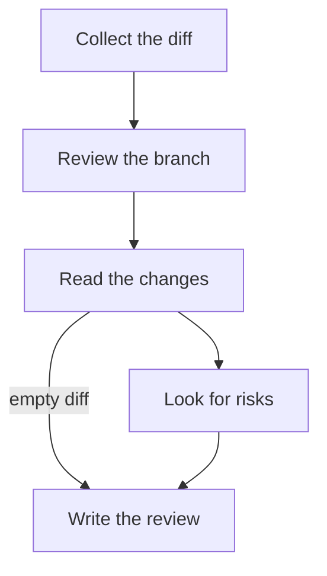

# Review this branch

The input block below holds the commit list and the diff of this branch against its base. Each
`##` section is one step of the chart. Do not change files, commit, push or comment anywhere: this
review is read in the run record.

## Read the changes {#read}

Read the commits and the diff. Open files in the repository only when the diff needs more context.
If the diff is empty, go straight to `write`; otherwise go to `risks`.

## Look for risks {#risks}

Look for bugs, missing tests, security problems and changes that break callers. Ignore formatting
and naming unless they hide a bug. Then go to `write`.

## Write the review {#write}

At most ten findings, most serious first, each with the file, the line and one sentence on why it
matters. If there is nothing worth raising, say so in one line.

Record the review with a one-line summary, such as "Reviewed <branch>: <n> findings". Finish with
one short message for the reader: how many findings on which branch, and the most serious one.