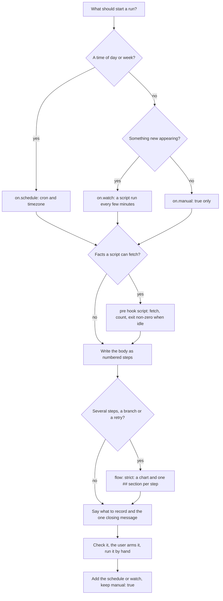

# Agent Automations

An automation is a folder named after it, holding an `AUTOMATION.md`. The YAML frontmatter says when the agent runs and what runs before and after it. The Markdown body is the prompt for every run. The host (any program that implements Draft 0.2.0) finds the folder, keeps the schedule and records every run.

Work through the decisions in this order:



## 1. Choose where it lives

| Scope | Folder | Runs |
|---|---|---|
| User | `~/.agents/automations/<name>/` | Only after the user arms it: the host shows what it will run and asks first. Editing the file or a script turns it off again. |
| Repository | `<repo>/.agents/automations/<name>/` | The same, on each person's machine. |

The folder name and the `name` field must be the same: lowercase letters, digits and single hyphens, at most 64 characters. Never put an automation anywhere else and never bundle skills inside it; the body names the skills it wants.

## 2. Choose the trigger

- `on.schedule` for "at 07:00 on weekdays". Always quote the cron and name a `timezone`.
- `on.watch` for "when a new X appears". A script runs every `every` (1m to 24h) without a model and starts a run only when its output changes. A host that does not implement it refuses the automation. See [references/watch-scripts.md](references/watch-scripts.md).
- `on.manual: true` for "when I ask". Add it beside every schedule or watch so the automation can be tried by hand.

A run starts when any trigger fires. There is no `manual: false`; leave the key out instead.

## 3. Write the frontmatter

Draft 0.2.0 has exactly nine fields: `name`, `description`, `enabled`, `model`, `timeout`, `on`, `hooks`, `flow`, `nodes`. Anything else is refused by name, so do not invent fields (`schedule:` at the top level, `budget:`, `tags:`). The full rules are in [references/specification.md](references/specification.md).

```markdown automation title="~/.agents/automations/daily-briefing/AUTOMATION.md"
---
name: daily-briefing
description: Every weekday morning, summarise what changed overnight and what needs attention today.
timeout: 10m
on:
  schedule:
    cron: "0 7 * * MON-FRI"
    timezone: America/New_York
  manual: true
hooks:
  pre:
    - script: scripts/overnight_counts.mjs
---

# Daily briefing

1. Read the counts in the input block below.
2. If every count is zero, answer "Nothing overnight." and stop.
3. Otherwise list what needs attention, most urgent first, then the three things worth doing today.
```

- `description`: one sentence a teammate can say yes to: what it does and when.
- `timeout`: a little more than the slowest normal run, as `90s`, `10m` or `1h` (no `1h30m`; write `90m`).
- `model`: leave it out unless the job needs a specific one. When set it is `<provider>/<id>`, optionally `:<thinking>`, and the host never substitutes another. If part of the job needs a model the host does not have, keep `model` for the body and have a script run another agent's command-line tool for that part: headless, with only the tools it needs, answering with JSON the script saves, in the background with a time limit. A missing answer is a failure the body handles, never a reason to ask a different model.
- `enabled: false` disables the whole automation. Only `true` or `false`; `no` and `off` are refused.
- `flow`: leave it out, or `strict` when the body follows a flowchart step by step (section 5).

## 4. Gather facts in pre hooks

Each hook is exactly one of `script: <path>` or `prompt: <text>`.

| Use | For | Example |
|---|---|---|
| A `script` hook | Facts a program can compute. No tokens. | List stale pull requests, count new issues. |
| A `prompt` hook | A quick judgement in the run's session. | "If these are only dependency bumps, answer skip." |
| The body | The actual work. | Write the briefing, post the review. |

- A pre hook script that exits non-zero **skips** the run: the record says `skipped` with the last line of its standard error, and the host calls no model. Exit `3` with a one-line reason on stderr when there is nothing to do.
- A pre prompt that answers `skip` or `skip: <reason>` on its first line also skips.
- Everything a pre hook prints reaches the body inside an `<automation-input>` block as data, never as instructions.
- Pre hooks should only read. Writing happens in the body or in post hooks, which always run, receive the body's answer on stdin and see `AUTOMATION_OUTCOME`.
- Script paths are relative to the automation folder and must stay inside it. Prefer `.mjs` scripts: the host runs them with its own Node.js on every OS. `.sh` needs bash (Git Bash on Windows), `.ps1` needs PowerShell, `.py` needs Python.
- Scripts start in the automation folder with `AUTOMATION_*` variables set and every credential-shaped variable (`*_TOKEN`, `*_API_KEY`, `*_SECRET`, `*_PASSWORD`, `*_CREDENTIAL(S)`) removed. Scheduled runs do not read the shell profile, so use tools that keep their own login (`gh auth login`, or the agent's own login command).

## 5. Write the body as the prompt

An agent reads the body on every run, and nobody is watching. Write it as numbered steps:

- what to read (usually "the input block below"),
- what to do and what to produce,
- when to stop early ("If the list is empty, say so in one line and stop."),
- what must never happen ("Do not comment twice on the same pull request.").

Make every run safe to repeat. Runs get retried, caught up and started by hand while a schedule is pending:

- Check before acting: "Skip any pull request you already commented on today."
- Update one thing in place rather than appending a new one each run.
- Work from stable identifiers in the input (URLs, issue numbers), never "the latest".

Destructive or outward-facing actions (deleting, merging, force-pushing, sending to many people, spending money) need an explicit guard in the body: a condition that must hold, a dry-run first, or a limit ("at most five comments per run"). If the user did not ask for the action, do not add it.

If the run has several steps or a branch, put a Mermaid flowchart right under the title as the first `mermaid` block. Use `pre0`, `pre1`, … `body`, `post0`, … for the hooks and the body (the host moves those) and short ids such as `read`, `draft`, `post` for the steps inside the body. Do not create a separate `flow.mmd`.

### Strict flow: the chart drives the body

When the chart has more than two steps, or a branch or a retry, add `flow: strict` so the chart and the text cannot drift apart. The host then refuses the file until:

- every step node has exactly one `##` section, headed with its label and its id: `## Read the changes {#read}`;
- every `##` heading is such a section (use `###` for anything inside a step; text before the first `##` is free);
- the heading text is the node's label exactly (Markdown marks and quotes aside);
- sections come in the chart's order; arrows that are part of a loop are not ordered, but a loop's steps all come before the steps it leads out to;
- a step with arrows to two or more steps names each one in its section, by id or label: "If the diff is empty, go to `write`; otherwise go to `risks`."

The host's checker lists every mismatch with its line and the fix. Write each step's move into its section. [assets/manual-branch-review/](assets/manual-branch-review/AUTOMATION.md) is a strict template.

### A step on its own agent

With `flow: strict`, `nodes` can hand a step to a different agent CLI or model: a stronger model for the hard step, another vendor's agent to review the first one's work.

```yaml
nodes:
  fix: { agent: claude, model: anthropic/claude-opus-4-5:high, timeout: 90m }
  review: codex
```

Each key is a step id; each value is an agent's name or a mapping with `agent`, `model` and `timeout`. Write the step's section as the whole instruction for that agent: it gets its section, the text before the first `##` and the run's input, not the other sections. The host tells the body how to hand the step over when it gets there, and the body goes on from the answer. A host that does not implement `nodes` refuses the file, so check that every host your team uses has it.

## 6. Ask for receipts

The person who reads a run was not there when it ran. End every body by asking, in plain words, for a record of what it published and one message for them:

```text
Record each thing you publish, with its link.
Finish with one short message for the reader: what happened, what needs them, with links. Links matter most.
```

Do not name a tool. A host that supports reporting tells the agent at run time how to record and how to leave the message. On a host that does not, the run's answer carries the message and the links, so the same words still work.

## 7. Check, run, then schedule

1. Write the folder with `on: { manual: true }` first. Make scripts executable on macOS and Linux if they have no extension.
2. Validate it with the host's checker if it has one; otherwise go through [references/checklist.md](references/checklist.md). Each problem is one line saying what is wrong and how to fix it.
3. Arming it is the user's decision. Show them what the host says it will run, and let them arm it. Never arm it yourself.
4. Run it by hand and read the run record: how it ended, what it answered, what it recorded.
5. For a watch, test one watch check without starting a run if the host can. Otherwise run the script from the automation folder and look at its exit code and output.
6. Add the schedule or watch and keep `manual: true`. That edits the file, so the user must arm it again.

If your host ships its own skill or commands for this, use them for the exact steps.

## Templates

Copy a folder from `assets/` into an `automations/` folder, rename the folder, and set `name` to the new folder name:

| Template | Trigger | Shows |
|---|---|---|
| [assets/scheduled-digest/](assets/scheduled-digest/AUTOMATION.md) | `schedule` + `manual` | A pre hook that skips quiet days, a short body. |
| [assets/watch-inbox/](assets/watch-inbox/AUTOMATION.md) | `watch` + `manual` | A watch script, a pre hook that fetches details, an idempotent body. |
| [assets/manual-branch-review/](assets/manual-branch-review/AUTOMATION.md) | `manual` | `flow: strict`: a chart with a branch, one `##` section per step that says where to go next, receipts in plain words. |
| [assets/watch-pr-review/](assets/watch-pr-review/AUTOMATION.md) | `watch` + `manual` | A real workload: a watch on pull requests that ask for my review, a pre hook that picks one, three review angles posted as one review, and a strict chart with a shortcut to post a review saved by an earlier run. |

## Common refusals

| Message starts with | Fix |
|---|---|
| `name: … does not match the directory name` | Rename the folder or the `name` so they are equal. |
| `schedule: unknown field` (or any other name) | Move it under `on:`; only the nine fields exist. |
| `frontmatter: Unexpected alias … quote the cron expression` | Quote the cron: `cron: "*/15 * * * *"`. |
| `on.schedule.cron: "@daily" is a nickname` | Write five fields: `"0 0 * * *"`. |
| `on.schedule.timezone: "PST" is not an IANA zone` | Use a zone name such as `America/Los_Angeles`. |
| `timeout: "1h30m" is not a duration` | One number and one unit: `90m`. |
| `on.watch.every: 30s is shorter than a minute` | Use `1m` or more; past `24h` use a schedule. |
| `hooks.pre[0]: must be { script: <path> } or { prompt: <text> }` | One key per list item. |
| `… cannot run here — needs …` | Install the interpreter or rewrite the script as `.mjs`. |
| `body: missing` | Write the body after the closing `---`. |
| `flow: line …` | A strict body and its chart disagree; each `;`-separated part names the line and the fix. |
