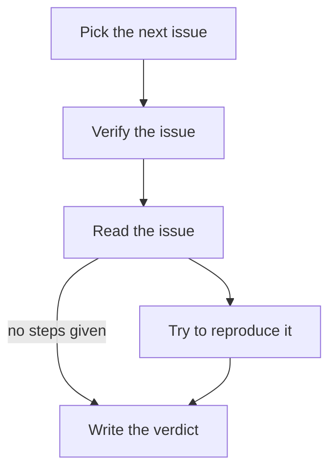

# Reporting with `pa`

pi-automations lets a run report where it has got to and what it published. Draft 0.2 does not define this, and other hosts may not have it.

The body, every hook and anything they start get `AUTOMATION_RUN` and `AUTOMATION_STATE_DIR`, and `pa` first on `PATH`. No arguments are needed to find the run.

## Contents

- [Notes: every run](#notes-every-run)
- [The message: one per run](#the-message-one-per-run)
- [Steps: tracked runs](#steps-tracked-runs)
- [Exit codes and JSON](#exit-codes-and-json)
- [Body wording](#body-wording)

## Notes: every run

```sh
pa note "Posted the weekly digest" --link "digest=https://example.com/digests/2026-w10"
pa note "Reviewed o/r#7 and o/r#9" --link "https://github.com/o/r/pull/7" --link "https://github.com/o/r/pull/9"
pa note "Digest sent" --request-id digest-2026-w10   # a retry with the same id adds nothing
```

- The text is Markdown. Text longer than 4000 characters is cut, with a warning.
- A link is `label=URL` or a bare URL. Only `http` and `https` are kept; one bad link refuses the whole note.
- Notes show on its run page in `/automations`, in `pa runs <name>`, in the transcript entry and in the HTML report.

## The message: one per run

Notes are the log. The message is what the person reads first: what happened, what needs them, and the links to go there. End every run with exactly one:

```sh
pa message "Digest is up; 2 pull requests wait on you" --link "digest=https://example.com/digests/2026-w10" --link "https://github.com/o/r/pull/7"
```

- Links matter most: link everything the person might open next.
- A later `pa message` replaces the earlier one. Text, links and `--request-id` work as for a note.
- It shows under the list in `/automations`, first on its run page, in `pa runs` and `pa status`, and in the Automation Manager's History. A run with no message is shown by its notes, else by its answer.

## Steps: tracked runs

A run is tracked when the body's first `mermaid` block is a `flowchart` or `graph` (or the automation is listed in `flowTracking` in the host config). The host moves `pre0`, `pre1`, …, `body`, `post0`, …; the agent moves every other node.

| Command | Does |
|---|---|
| `pa step <node> [--status active\|waiting\|done\|failed\|skipped] [-m "text"]` | Sets one node; `active` by default. |
| `pa next <to> [--from <node>] [-m "text"]` | Marks the current node done, `<to>` active, and records the arrow taken. `--from` defaults to `AUTOMATION_NODE`, else the one running node. |
| `pa say "text" [--node <node>] [--request-id <key>]` | Adds an update to a node. |
| `pa status [--json]` | Every node, the arrows taken, the notes, the message. |

- A node is named by its id or its exact label. An unknown one is refused with suggestions.
- Repeating the same `step` or `next` changes nothing. Several processes may report at once.
- A node still `active` or `waiting` when the run ends is recorded `interrupted`.
- For subagents, set `AUTOMATION_NODE=<their node>` so their `pa say` and `pa next` land there.
- With `flow: strict`, `pa next` must follow an arrow of the chart; any other move is refused with `NOT_AN_EDGE` and the steps it can go to. Moves between hooks and `body` are the host's and are not checked. `pa step` is not restricted.

## Exit codes and JSON

Every in-run command takes `--json` and then prints one object, `{"ok":true,…}` or `{"ok":false,"error":{"code":…}}`.

| Exit | Codes |
|---|---|
| `0` | ok |
| `1` | `USAGE`, `BAD_LINK` |
| `2` | `NO_RUN` (not in a run), `UNKNOWN_RUN`, `RUN_CLOSED`, `NO_CHART` (`step`/`next`/`say` without a chart), `UNKNOWN_NODE`, `AMBIGUOUS_NODE`, `NO_ACTIVE`, `AMBIGUOUS_ACTIVE`, `NOT_AN_EDGE` (strict flow), `LOCK_TIMEOUT`, `IO` |

Progress never changes a run's outcome; a failing `pa` only loses that report.

## Body wording

The host already adds a short `<notes>` block to every run's prompt, or a `<progress>` block when the run is tracked:

```text
<notes>
When the instructions ask you to record what you published or to leave a message, use these commands.
If you publish anything or leave something for the reader, record it with `pa note "what it is" --link "label=https://…"` (AUTOMATION_RUN is already set).
Before you finish, leave the reader ONE message: `pa message "what happened / what needs you" --link "label=https://…"`. Links matter most; a later message replaces the earlier one.
If `pa` fails, carry on.
</notes>
```

So a body that asks in plain words ("Record each thing you publish, with its link. Finish with one short message for the reader.") works here and on other hosts. Naming `pa` in the body is optional and pi-only: it pins down exactly which step moves when. If you do, end with "If `pa` fails, carry on.":

````markdown automation title=".agents/automations/issue-verify/AUTOMATION.md"
---
name: issue-verify
description: Every Monday, pick the next unverified issue and check whether it still reproduces.
on:
  schedule:
    cron: "0 9 * * MON"
    timezone: UTC
  manual: true
hooks:
  pre:
    - script: scripts/next_issue.mjs
---

# Verify one issue



1. `pa step read`, then read the issue in the input block.
2. If it lists steps, `pa next repro --from read` and try them, then `pa next verdict --from repro`.
   Otherwise `pa next verdict --from read`.
3. Comment the verdict on the issue, then `pa step verdict --status done` and
   `pa note "Verdict on #<n>" --link "issue=<url>"`.
4. Finish with one `pa message "<the verdict, and what it needs from me>" --link "issue=<url>"`.

If `pa` fails, carry on.
````

Pass `--from` from the body: its `AUTOMATION_NODE` is `body`, so a bare `pa next` would finish `body` rather than the step you are on.
